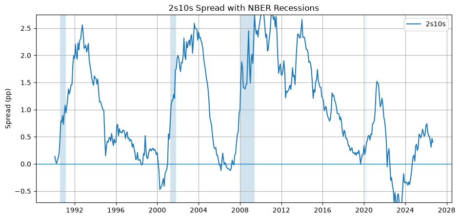
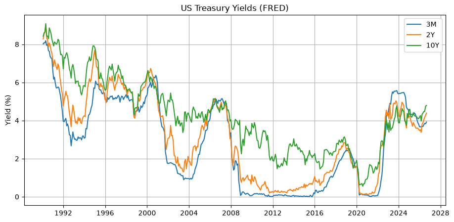
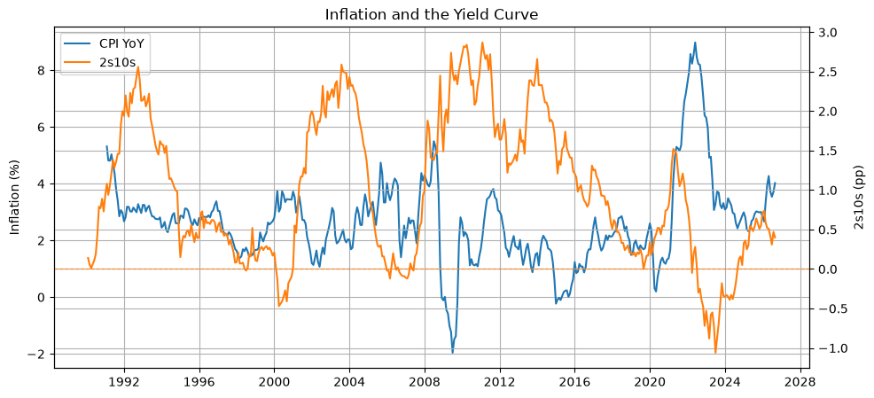

# US yield curve and spread analysis

The slope of the US Treasury curve is the most watched recession signal in macro. This notebook pulls the curve from FRED, builds the two classic spreads, overlays the NBER recession dates and puts inflation next to the curve, so the "inverted curve" story can be checked against the data instead of retold. The data run from 1990 to the latest month and refresh on every run. No API key is needed.



## What it does

1. Downloads the 3-month, 2-year and 10-year constant-maturity yields, CPI and the NBER recession indicator from FRED through `pandas-datareader`.
2. Forward-fills yields across weekends and holidays, then aligns everything on the monthly CPI grid.
3. Builds the spreads 2s10s = 10Y − 2Y and 3m10y = 10Y − 3M and plots the regimes against the zero line.
4. Shades NBER recessions so that inversions can be read against outcomes.
5. Puts CPI year-on-year inflation next to the 2s10s spread.

<p align="center">
  
  
</p>

## What the data show (monthly observations, 1990 to 2026)

| 2s10s inversion | Length | Deepest | Next NBER recession |
|---|---|---|---|
| Mar 2000 to Dec 2000 | 10 months | −0.47 pp | Apr 2001 |
| Jan 2006 to Mar 2007, with a gap | 10 months | −0.12 pp | Jan 2008 |
| Aug 2022 to Aug 2024 | 25 months | −1.06 pp | none dated so far |

- The 3m10y spread tells the same story and adds a short inversion in mid-2019 ahead of the 2020 recession, which had a non-financial cause.
- The 2022 to 2024 inversion is the longest and deepest in the sample and, as of the latest data, the first since 1990 with no NBER-dated recession behind it. Whether that is a false signal or a long lag is the question the next steps are built around.
- Each inversion follows a run-up in inflation and a hiking cycle (2000, 2006 to 2007, 2022), which is the mechanism the last chart is there to show.
- At the time of writing (October 2026) both spreads are positive again: 2s10s at +0.46 pp and 3m10y at +1.07 pp.

## Next steps

1. Fit the classic recession-probability probit (Estrella and Mishkin) on the 3m10y spread at a 12-month horizon and report its out-of-sample record, including the 2022 to 2024 episode.
2. Separate the expectations component from the term premium with a published term-premium series, since a compressed premium can invert the curve without a growth signal.
3. Event study around the 2022 to 2024 inversion: unemployment, credit spreads and industrial production, to see which of the usual companions of an inversion did and did not follow.

## Run it

```bash
pip install -r requirements.txt
jupyter lab yield_curve_spreads.ipynb
```

No account or key is needed. All outputs are stored in the notebook, so the charts can be read on GitHub without running anything.

## Layout

| Path | Contents |
|---|---|
| `yield_curve_spreads.ipynb` | Data pull, spreads, recession overlay, inflation chart, outputs included |
| `figures/` | Charts exported from the notebook |
| `requirements.txt` | pandas, numpy, matplotlib, pandas-datareader, JupyterLab |

## Data

FRED series `DGS3MO`, `DGS2` and `DGS10` (constant-maturity Treasury yields, daily), `CPIAUCSL` (CPI, monthly) and `USREC` (NBER recession indicator, monthly).

## License

MIT. See [LICENSE](LICENSE).
